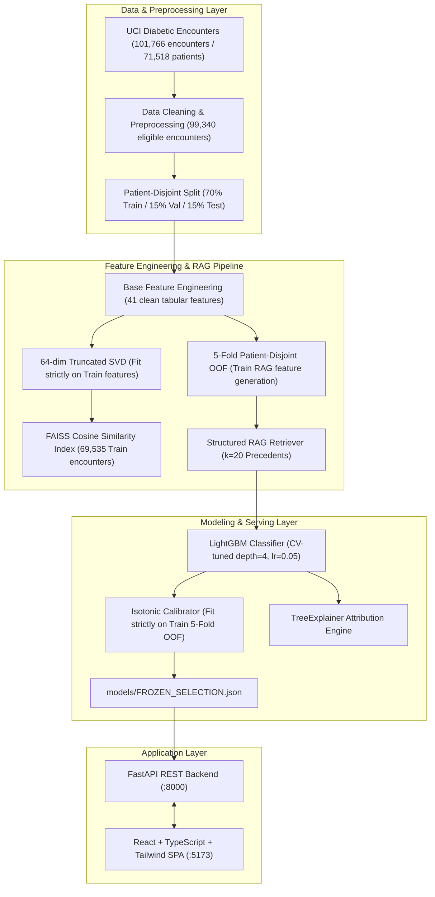
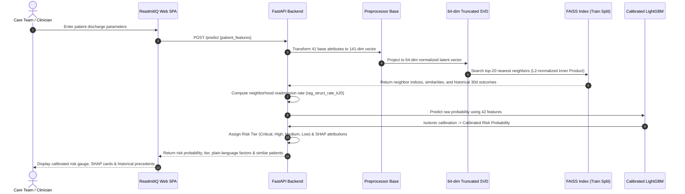

# ReadmitIQ System Architecture

ReadmitIQ is an end-to-end clinical decision support platform for 30-day hospital readmission risk prediction among diabetic inpatients.

---

## 1. High-Level System Architecture

---

## 2. Structured RAG Retrieval Mechanism

The Structured RAG engine provides explainable case-based clinical reasoning by identifying the historical patients in the training set who most closely resemble the current patient:

---

## 3. Retrospective Cohort Replay Architecture

To simulate operational clinical workload allocation, the Cohort Command Center performs real-time capacity triage replay on the held-out Test split (N = 14,903):

- **Capacity Fraction ($c$):** Adjustable from 1% to 30%.
- **Flagged Volume ($N_c$):** $N_c = \text{round}(c \times 14,903)$.
- **True Readmissions Caught ($R_c$):** Number of true $<30$-day readmissions in top $N_c$ ranked patients.
- **Precision at Capacity:** $P_c = R_c / N_c$.
- **Lift vs Random Prevalence:** $\text{Lift} = P_c / 0.1137$.
